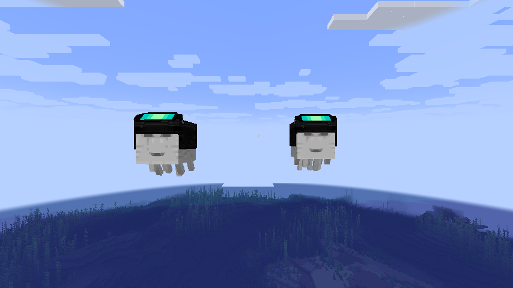

# Avaritia Harness Backport

仓库：https://github.com/lyingice/AvaritiaHarnessBackport



把 **Re:Avaritia（无尽贪婪：重生）** 高版本中的 **星空挽具 / Neutron Harness** 移植到 **1.20.1 Forge** 与 **1.21.1 NeoForge**，并兼容两个快乐恶魂回溯模组：

- [Vanilla Backport](https://modrinth.com/mod/vanillabackport)（`vanillabackport`）
- [Happy Ghast Legacy](https://modrinth.com/mod/happy-ghast-legacy)（`happy_ghast_legacy`）

## 支持版本

| Minecraft | Loader | Re:Avaritia | Vanilla Backport | Happy Ghast Legacy |
|---|---|---|---|---|
| 1.21.1 | NeoForge 21.1.215 | 1.4.4 | 1.2.2 | 1.8 |
| 1.20.1 | Forge 47.4.20 | 1.4.4 | 1.2.2 | 1.8 |

> Re:Avaritia 是**必需**前置。Vanilla Backport / Happy Ghast Legacy 至少安装一个，才能获得用于合成的基础挽具。

## 物品

- 注册名：`avaritia_harness_backport:neutron_harness`
- 中文名：星空挽具（旧名「中子战魂铠」）
- 装备槽：**CHEST**（1.20.1/1.21.1 没有高版本的 BODY 槽）
- 属性：+50 护甲、+10 盔甲韧性
- 固定附魔：保护 X
- 骑乘时：+0.45 飞行速度
- 火焰抗性；死亡/岩浆/爆炸后以不朽物品实体掉落
- 不可损坏、无附魔光效

### 合成

在 **终焉锻造台** 中使用：

- 羽化模板 `avaritia:upgrade_smithing_template`
- 任意彩色挽具（VB 的 `minecraft:*_harness` 或 HGL 的 `happy_ghast_legacy:*_harness`）
- 缓降药水
- 无瑕核心 `avaritia:enhancement_core`
- 羽毛

若两个回溯模组都未安装，基础挽具标签为空，配方不可用。

## 26.1.2 专属机制

这些机制不在 `NeutronHarnessItem` 本身，而在 Re:Avaritia 26.1.2 分支的：

- `init/handler/NeutronHarnessHandler.java`
- `common/component/HarnessOwner.java`
- `common/component/HarnessShieldState.java`
- `common/net/C2SHarnessActionPacket.java`
- `init/registry/ModDataAttachments.java`

本移植已按 26.1.2 的实现补齐。

### 80% 减伤

穿戴星空挽具的快乐恶魂受到的伤害乘以 `1 - harness_ghast_damage_reduction`，默认 **0.8**，即减免 80%。护盾取消伤害时优先于该减伤。

### 立体防御护盾

- 必须**骑着穿铠的快乐恶魂**才能展开
- 锚点是坐骑恶魂
- 半径默认 **4 格**
- 持续默认 **15 秒**，冷却默认 **20 秒**
- 护盾球面用 16 个 `END_ROD` 粒子绘制
- 范围内：
  - 锚点恶魂及其骑乘者免疫一切伤害
  - 非敌对（友方/中立）实体免疫一切伤害
  - 敌对实体不受保护
- 冷却与护盾结束时刻写入玩家持久 NBT

### 召唤善良恶魂坐骑

- 玩家必须处于**腾空**状态（不在地面、未骑乘）
- 在当前维度已加载实体中寻找最近的穿铠快乐恶魂
- 优先自己名下的恶魂，其次无主恶魂；不会抢其他玩家的恶魂
- 恶魂瞬移到玩家脚下并让玩家骑乘；脚下放不下时播放失败音效
- 第一次骑上穿铠恶魂的玩家成为它的主人

### 配置

配置文件：`config/avaritia_harness_backport-common.toml`

| 配置项 | 默认值 | 范围 | 说明 |
|---|---|---|---|
| `harness_shield_radius` | 4.0 | 1–32 | 护盾半径 |
| `harness_shield_duration_seconds` | 15 | 1–120 | 护盾持续时间 |
| `harness_shield_cooldown_seconds` | 20 | 0–600 | 护盾冷却 |
| `harness_ghast_damage_reduction` | 0.8 | 0–1 | 穿铠恶魂减伤比例 |

### 按键

在「控制」中自行绑定，默认**不绑定**：

- `召唤善良恶魂坐骑`
- `展开立体防御护盾`

## 版本差异

26.1.2 与 1.21.11/26.3 的星空挽具不是同一套数值：

| 版本 | 基础飞行速度 | 骑乘速度 | 护盾/召唤/80% 减伤 |
|---|---|---|---|
| 26.1.2 | 无 | +0.45（handler） | 有 |
| 1.21.11 / 26.3 | +0.95 | 无 | 无 |

MC百科页面把两代内容混在了一起，并且页面写护盾「5 秒 / 15 秒」，而 26.1.2 代码默认是 **15 秒 / 20 秒**。本移植以 26.1.2 代码为准，四项数值都可以在配置里调整。

## 兼容说明

### Vanilla Backport

纯数据兼容：

- 物品加入 `minecraft:harnesses` 标签
- 提供 `assets/avaritia_harness_backport/equipment/ghast/neutron_harness.json`
- 由 VB 自己完成右键装备、骑乘、属性与渲染

### Happy Ghast Legacy

HGL 只接受自己的 `HarnessItem` 类，因此本模组：

- 监听 `PlayerInteractEvent.EntityInteract`，直接把物品写入 CHEST 槽
- 通过自定义 `RenderLayer` 渲染星空挽具
- 不引用 HGL 的 Java 类，也不复制其代码/资源

> HGL 的 `travel()` 硬编码飞行速度，不使用 `Attributes.FLYING_SPEED`。本模组通过软失败 Mixin（`@Pseudo` + `@ModifyConstant`）把 `0.09F` 乘以 `(0.32 + 0.45) / 0.32 ≈ 2.41`，**仅在玩家骑乘时**生效，对应 26.1.2 的 +0.45 骑乘速度。HGL 未安装或实现变化时 Mixin 自动跳过。

## 构建

需要 JDK 17/21（Gradle toolchain 会自动处理）。首次构建前先下载测试/编译用的本地 jar：

```bash
./scripts/download-test-mods.sh
```

然后：

```bash
# 1.21.1 NeoForge
./gradlew :neoforge-1.21.1:build

# 1.20.1 Forge
./gradlew :forge-1.20.1:build
```

产物：

- `neoforge-1.21.1/build/libs/avaritia_harness_backport-neoforge-1.21.1-0.1.0.jar`
- `forge-1.20.1/build/libs/avaritia_harness_backport-forge-1.20.1-0.1.0.jar`

### 1.20.1 Forge 的本地前置

ForgeGradle 的 `fg.deobf` 无法直接解析 Modrinth Maven 坐标，因此需要把 Re:Avaritia 1.20.1 的 jar 放到：

```text
forge-1.20.1/libs/Re-Avaritia-forge-1.20.1-1.4.4-release-1.0.jar
```

下载：

```bash
mkdir -p forge-1.20.1/libs
curl -L -o forge-1.20.1/libs/Re-Avaritia-forge-1.20.1-1.4.4-release-1.0.jar \
  https://cdn.modrinth.com/data/QeB3NRC5/versions/PIZk2hki/Re-Avaritia-forge-1.20.1-1.4.4-release.jar
```

> 该文件已被 `.gitignore` 忽略，不会提交到仓库。

## 开发测试

### 1.21.1 NeoForge GameTest

```bash
./gradlew :neoforge-1.21.1:runGameTestServer --configure-on-demand
```

9 个测试覆盖：

- 物品、标签、配方注册
- 保护 X
- VB/HGL 恶魂的护甲/韧性属性
- 配方匹配与产出
- HGL 右键装备
- HGL 骑乘速度 Mixin（x2.40625）
- +0.45 骑乘速度修饰符的添加/移除
- 80% 减伤
- 护盾对锚点/友方/敌对的保护判定

### 1.21.1 可视化回归

需要存在存档 `neoforge-1.21.1/run/saves/新的世界`：

```bash
./gradlew :neoforge-1.21.1:runVisualTestClient
```

会自动生成两只穿星空挽具的快乐恶魂，并把截图写入 `neoforge-1.21.1/run/screenshots/`。

### 1.20.1 Forge

```bash
./gradlew :forge-1.20.1:runServer
```

> 开发环境的 official 映射与 Re:Avaritia 生产 jar 的 Mixin refmap（SRG）不兼容，因此完整验证建议使用生产 Forge 服务端 + reobf jar。`./gradlew :forge-1.20.1:build` 会生成可用的 reobf 产物。当前已在生产服务端验证：模组加载、配置生成、HGL Mixin 生效、CHEST 槽写入。

## 已知限制

- 1.20.1 Forge 客户端渲染建议再做一次实机视觉检查。
- 1.20.1 Forge 暂未接入 GameTest；核心判定逻辑已在 NeoForge GameTest 覆盖，Forge 端通过生产服务端加载/配置验证。
- 1.20.1 Fabric / 1.21.1 Fabric 未纳入当前范围。

## 许可

本模组使用 MIT 许可。Re:Avaritia 的资源与行为按其 MIT 许可使用，详见 [ATTRIBUTION.md](ATTRIBUTION.md)。
